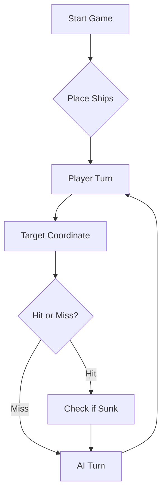

Link do vídeo: https://youtu.be/Xh_x-fIy_xs?si=MmSxZtxxPKf9s_xw

# ⚓ Battleship 2.0


> A modern take on the classic naval warfare game, designed for the XVII century setting with updated software engineering patterns.

---

## 📖 Table of Contents
- [Project Overview](#-project-overview)
- [Key Features](#-key-features)
- [Technical Stack](#-technical-stack)
- [Installation & Setup](#-installation--setup)
- [Code Architecture](#-code-architecture)
- [Roadmap](#-roadmap)
- [Prompt](#-prompt)
- [Contributing](#-contributing)
- [Nota Final](#-nota-final)

---

## 🎯 Project Overview
This project serves as a template and reference for students learning **Object-Oriented Programming (OOP)** and **Software Quality**. It simulates a battleship environment where players must strategically place ships and sink the enemy fleet.

### 🎮 The Rules
The game is played on a grid (typically 10x10). The coordinate system is defined as:

$$(x, y) \in \{0, \dots, 9\} \times \{0, \dots, 9\}$$

Hits are calculated based on the intersection of the shot vector and the ship's bounding box.

---

## ✨ Key Features
| Feature | Description | Status |
| :--- | :--- | :---: |
| **Grid System** | Flexible $N \times N$ board generation. | ✅ |
| **Ship Varieties** | Galleons, Frigates, and Brigantines (XVII Century theme). | ✅ |
| **AI Opponent** | Heuristic-based targeting system. | 🚧 |
| **Network Play** | Socket-based multiplayer. | ❌ |

---

## 🛠 Technical Stack
* **Language:** Java 17
* **Build Tool:** Maven / Gradle
* **Testing:** JUnit 5
* **Logging:** Log4j2

---

## 🚀 Installation & Setup

### Prerequisites
* JDK 17 or higher
* Git

### Step-by-Step
1. **Clone the repository:**
   ```bash
   git clone [https://github.com/britoeabreu/Battleship2.git](https://github.com/britoeabreu/Battleship2.git)
   ```
2. **Navigate to directory:**
   ```bash
   cd Battleship2
   ```
3. **Compile and Run:**
   ```bash
   javac Main.java && java Main
   ```

---

## 📚 Documentation

You can access the generated Javadoc here:

👉 [Battleship2 API Documentation](https://britoeabreu.github.io/Battleship2/)


### Core Logic
```java
public class Ship {
    private String name;
    private int size;
    private boolean isSunk;

    // TODO: Implement damage logic
    public void hit() {
        // Implementation here
    }
}
```

### Design Patterns Used:
- **Strategy Pattern:** For different AI difficulty levels.
- **Observer Pattern:** To update the UI when a ship is hit.
</details>

### Logic Flow


---

## 🗺 Roadmap
- [x] Basic grid implementation
- [x] Ship placement validation
- [ ] Add sound effects (SFX)
- [ ] Implement "Fog of War" mechanic
- [ ] **Multiplayer Integration** (High Priority)

---

## 🧪 Testing
We use high-coverage unit testing to ensure game stability. Run tests using:
```bash
mvn test
```

> [!TIP]
> Use the `-Dtest=ClassName` flag to run specific test suites during development.

---

## Prompt
A partir de agora, vais jogar como um jogador experiente, seguindo estas regras em todas as partidas:
- **Diário de Bordo:** Cria e atualiza um registo sequencial de cada rajada (Rajada 1, 2, 3...). Guarda sempre as coordenadas exatas de cada tiro e o respetivo resultado (Água, Navio atingido, Navio afundado, etc.) para consultares sempre que precisares.
- **Sem desperdícios:** Não dispares para fora do tabuleiro nem repites tiros em sítios onde já tentaste a tua sorte. A única exceção é na última jogada do jogo, estritamente para cumprir os 3 tiros obrigatórios quando a frota adversária já estiver toda no fundo do mar.
- **Caça ao navio:** Se acertares num navio, na jogada seguinte foca os teus disparos nas posições vizinhas (Norte, Sul, Este, Oeste) para perceberes a orientação dele e mandá-lo a pique. Se o relatório da jogada anterior já confirmar que o navio afundou, nem vale a pena disparar para aí, porque os navios nunca estão encostados.
- **Regra das diagonais:** Como as Caravelas, Naus e Fragatas são sempre a direito, um tiro certeiro indica-te que o resto do navio está na horizontal ou vertical. E como os navios não se podem tocar (nem de canto), as posições na diagonal de um tiro certeiro são garantidamente água (à exceção do corpo em T do Galeão). Evitar essas diagonais vai poupar-te muitos tiros.
- **Perímetro de segurança:** Assim que um navio for dado como afundado, olha para o teu diário de bordo, descobre exatamente onde caíram os tiros e descarta toda a volta (o halo de 1 posição) como água. É fisicamente impossível haver outro barco colado ali.
- **Atitude:** Se a tua frota for toda afundada, assume a derrota de cabeça erguida. Se fores tu a vencer, sê elegante quando o oponente se render com os navios no fundo do oceano.

## 🤝 Contributing
Contributions are what make the open-source community such an amazing place to learn, inspire, and create.

1. Fork the Project
2. Create your Feature Branch (`git checkout -b feature/AmazingFeature`)
3. Commit your Changes (`git commit -m 'Add some AmazingFeature'`)
4. Push to the Branch (`git push origin feature/AmazingFeature`)
5. Open a **Pull Request**

---

## 📄 License
Distributed under the MIT License. See `LICENSE` for more information.

---
**Maintained by:** [@britoeabreu](https://github.com/britoeabreu)  
*Created for the Software Engineering students at ISCTE-IUL.*

## Nota final
O link correto da page é https://leti-129812.github.io/Battleship2/apidocs/index.html
